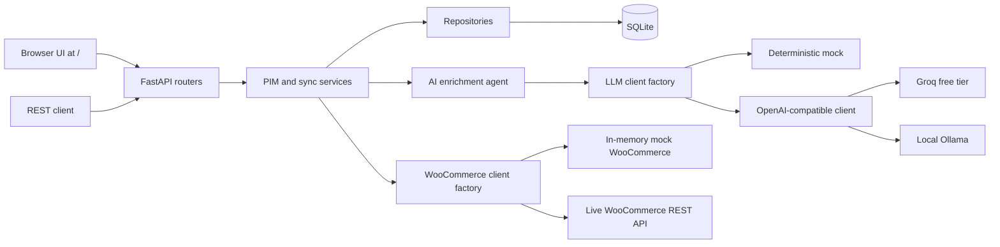
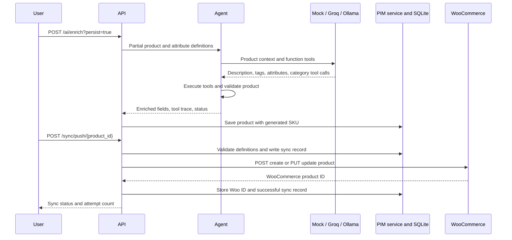

# Woo PIM AI

A small Product Information Management service for maintaining a product catalog, enriching product drafts with a function-calling AI workflow, and syncing products with WooCommerce. It runs on Python 3.11, FastAPI, SQLAlchemy, SQLite, and the OpenAI-compatible SDK. The default AI provider is deterministic and local, so the API and test suite work without network access, provider accounts, or keys.

## Features

- Create, read, update, delete, filter, and page through products.
- Define typed dynamic product attributes, including required fields, enumerations, and category scopes.
- Enrich a partial product with descriptions, tags, attributes, and a category using an auditable tool-call trace.
- Choose the mock provider, Groq, or a local Ollama server through environment configuration.
- Push and pull products with WooCommerce, keep a record of each sync attempt, and safely process signed, duplicate webhook deliveries.
- Run the complete test suite without an internet connection or API credentials.

## Architecture



### Enrich, validate, and push



## Design decisions

- **Repository pattern:** SQLAlchemy queries and persistence are kept behind small product, attribute, and sync repositories. Services apply validation and coordinate multiple repositories.
- **Factory pattern:** `get_llm_client()` selects the mock, Groq, or Ollama implementation from settings. The mock default makes ordinary development and tests deterministic.
- **Retry policy:** WooCommerce retries network/timeouts, HTTP 429, and 5xx responses up to five times with exponential jitter. It honors numeric and HTTP-date `Retry-After` values and does not retry other 4xx responses. LLM calls retry provider rate limits and timeouts with a smaller bound.
- **Conflict rule:** pull compares PIM `updated_at` to WooCommerce `date_modified` (or `date_modified_gmt`). A newer WooCommerce timestamp updates the PIM copy. A newer PIM timestamp wins, and ties go to the PIM. This is last-write-wins with a PIM tie-breaker.
- **LLM boundary:** one client protocol keeps provider-specific HTTP concerns out of the agent. The mock implements predictable keyword rules and keeps tests offline.
- **SQLite:** tables are initialized with SQLAlchemy `create_all`; SQLite is convenient for an MVP and supports a single writer workload.

## Setup

Use Python 3.11 and create a virtual environment:

```bash
python -m venv .venv
# Windows PowerShell: .venv\Scripts\Activate.ps1
# macOS / Linux:      source .venv/bin/activate
python -m pip install -r requirements.txt
Copy-Item .env.example .env  # Windows PowerShell
# cp .env.example .env        # macOS / Linux
```

The defaults in `.env.example` use the mock provider and `sqlite:///./pim.db`. Start the API with:

```bash
uvicorn src.main:app --reload
```

Open <http://127.0.0.1:8000/docs> for Swagger UI. Run all offline tests and lint with:

```bash
pytest -q
ruff check src tests
```

## Web UI

Start the server with `uvicorn src.main:app --reload`, then open <http://127.0.0.1:8000/>. The browser interface is plain HTML, CSS, and JavaScript; it calls the same REST API as `/docs` and requires no frontend build or separate development server.

- **Products:** browse and refresh the catalog, add a basic draft, push individual products to WooCommerce, and delete PIM products. The table includes the most recent sync status.
- **AI Enrich:** enter a title, optionally choose “Save product to catalog,” and run the enrichment agent. Review the description, tags, extracted attributes, category, completion badge, and step-by-step tool trace.
- **Sync:** push all catalog products, pull from WooCommerce, and inspect recent records with direction, status, retry attempts, errors, and time.

The UI displays API error messages in a toast and does not expose server stack traces. WooCommerce defaults to a built-in mock store, so push, pull, retries, and webhook demos work without a store account. AI enrichment works immediately with the default mock provider.

`make install`, `make run`, `make test`, and `make lint` are also available where Make is installed.

### Environment variables

| Variable | Default | Purpose |
| --- | --- | --- |
| `LLM_PROVIDER` | `mock` | `mock`, `groq`, or `ollama` |
| `GROQ_API_KEY` | empty | Free Groq API key; required only for Groq |
| `GROQ_BASE_URL` | `https://api.groq.com/openai/v1` | OpenAI-compatible Groq endpoint |
| `GROQ_MODEL` | `llama-3.3-70b-versatile` | Model selected for Groq |
| `OLLAMA_BASE_URL` | `http://localhost:11434/v1` | Local Ollama OpenAI-compatible endpoint |
| `OLLAMA_MODEL` | `llama3.1` | Model selected for Ollama |
| `LLM_TIMEOUT_SECONDS` | `30` | LLM request timeout |
| `DATABASE_URL` | `sqlite:///./pim.db` | SQLAlchemy database URL |
| `WOO_BASE_URL` | `https://your-store.example.com` | WooCommerce site root, without `/wp-json/wc/v3` |
| `WOO_CONSUMER_KEY` | empty | WooCommerce REST API consumer key |
| `WOO_CONSUMER_SECRET` | empty | WooCommerce REST API consumer secret |
| `WOO_WEBHOOK_SECRET` | empty | Secret configured for WooCommerce webhook signing |
| `WOO_MODE` | `mock` | `mock` uses a seeded local fake store; `live` connects to WooCommerce |
| `WOO_MOCK_FAIL_FIRST` | `0` | In mock mode, return temporary 503 responses for the first N requests to demonstrate retries |

Only `.env.example` belongs in version control. Keep real credentials in your local `.env`.

### Free AI providers

For Groq, create a free key from [console.groq.com](https://console.groq.com/), put it in `GROQ_API_KEY`, and set `LLM_PROVIDER=groq`. The model name can be changed with `GROQ_MODEL` without editing Python code. For local inference, install and start [Ollama](https://ollama.com/), download a tool-capable model, set `LLM_PROVIDER=ollama`, and configure `OLLAMA_MODEL` if needed. The default `mock` mode needs neither service.

### Mock vs Live WooCommerce

The default `WOO_MODE=mock` runs the production WooCommerce HTTP client against an in-memory fake store seeded with three products. Use **Push**, **Pull from WooCommerce**, or **Simulate webhook** in the Sync tab to demonstrate the full workflow without network access or credentials. Set `WOO_MOCK_FAIL_FIRST=2` to make the first two requests fail temporarily; the client retries and the sync record shows the attempt count.

For a real store, set `WOO_MODE=live` and provide `WOO_BASE_URL`, `WOO_CONSUMER_KEY`, `WOO_CONSUMER_SECRET`, and (for webhooks) `WOO_WEBHOOK_SECRET`. Live mode reports a clear configuration error if these values are missing or still placeholders. The mode badge in the UI shows which store is active.

In WooCommerce, create REST API credentials with the required product read/write permissions. For local experiments, a LocalWP WooCommerce site can be used if its URL is reachable by the Python process. Webhook deliveries must reach the API URL and use the same webhook secret. Live-mode integration tests use `respx`; mock-mode tests use the in-memory HTTP transport.

## REST API reference

| Method | Path | Description |
| --- | --- | --- |
| `GET` | `/health` | Check API and database connectivity |
| `POST` | `/products` | Create a product |
| `GET` | `/products?offset=0&limit=50&status=draft&category=Office` | Filter and page products |
| `GET` | `/products/{product_id}` | Read a product |
| `PATCH` | `/products/{product_id}` | Update product fields |
| `DELETE` | `/products/{product_id}` | Delete a product |
| `POST` | `/attributes` | Create an attribute definition |
| `GET` | `/attributes` | List definitions |
| `GET` | `/attributes/{attribute_id}` | Read a definition |
| `PATCH` | `/attributes/{attribute_id}` | Update a definition |
| `DELETE` | `/attributes/{attribute_id}` | Delete a definition |
| `POST` | `/ai/enrich?persist=false` | Enrich a partial product; optionally save it |
| `POST` | `/sync/push/{product_id}` | Push one product |
| `POST` | `/sync/push-all` | Push every product |
| `POST` | `/sync/pull` | Pull and upsert WooCommerce products |
| `GET` | `/sync/status` | List sync attempt records |
| `GET` | `/sync/status/{product_id}` | List attempts for one product |
| `GET` | `/sync/mode` | Report whether mock or live WooCommerce is active |
| `POST` | `/sync/webhook/woocommerce` | Receive a signed WooCommerce webhook |
| `POST` | `/sync/webhook/simulate` | Send a signed product update through the local webhook handler (mock mode only) |

### Example requests and responses

Create a product:

```bash
curl -X POST http://127.0.0.1:8000/products \
  -H 'Content-Type: application/json' \
  -d '{"sku":"MOUSE-001","title":"Wireless Ergonomic Mouse","description":"A comfortable wireless mouse.","price":29.99,"tags":["wireless"],"category":"Electronics > Accessories","attributes":{},"status":"draft"}'
```

```json
{"id":1,"sku":"MOUSE-001","title":"Wireless Ergonomic Mouse","description":"A comfortable wireless mouse.","price":29.99,"tags":["wireless"],"category":"Electronics > Accessories","attributes":{},"status":"draft","woo_id":null,"updated_at":"2026-10-13T12:00:00+00:00"}
```

Enrich and persist a draft (SKU is generated when omitted):

```bash
curl -X POST 'http://127.0.0.1:8000/ai/enrich?persist=true' \
  -H 'Content-Type: application/json' \
  -d '{"title":"Wireless Ergonomic Mouse"}'
```

The response contains `product`, a `trace` entry for each executed tool, `status` (`complete`, `partial`, or `failed`), `error`, and `persisted` (the saved product or `null`). Example shape:

```json
{"product":{"title":"Wireless Ergonomic Mouse","description":"...","tags":["wireless","ergonomic","mouse"],"attributes":{},"category":"Electronics > Accessories"},"trace":[{"iteration":1,"tool":"generate_description","arguments":{"title":"Wireless Ergonomic Mouse","context":{}},"result":"..."}],"status":"complete","error":null,"persisted":{"id":2,"sku":"AI-0123456789","title":"Wireless Ergonomic Mouse","status":"enriched"}}
```

Push a saved product and inspect its status:

```bash
curl -X POST http://127.0.0.1:8000/sync/push/2
curl http://127.0.0.1:8000/sync/status/2
```

Successful sync response shape:

```json
{"id":1,"product_id":2,"direction":"push","status":"success","attempts":1,"error":null,"created_at":"2026-10-13T12:00:00+00:00","completed_at":"2026-10-13T12:00:00+00:00"}
```

Errors use a consistent envelope:

```json
{"error":{"code":"conflict","message":"SKU 'MOUSE-001' already exists","details":null}}
```

## Assumptions & Limitations

- Variable products, product images, WooCommerce batch endpoints, and user authentication are outside this MVP.
- SQLite is intended for a single-writer workload; use a server database for concurrent production writes.
- Free LLM tiers can be rate limited. Provider failures produce partial enrichment when possible.
- Dynamic attribute definitions validate PIM create/update and sync payloads, but a WooCommerce store's own attribute taxonomy is not imported.
- Webhook signature verification uses the configured shared secret and raw request bytes. The deployment must expose a reachable HTTPS endpoint for live WooCommerce deliveries.
- A generated AI SKU uses a random `AI-` prefix and is checked for uniqueness by the database constraint; callers should provide a stable SKU for repeatable imports.

## Possible future improvements

- Add authentication, role-based access, and audit history for catalog edits.
- Support images, variable products, WooCommerce batch operations, and taxonomy mapping.
- Add background jobs for large syncs, per-product locking, and conflict review workflows.
- Move from SQLite to PostgreSQL and add migrations for schema evolution.
- Add configurable enrichment prompts, provider usage metrics, and stronger product-specific factual grounding.
